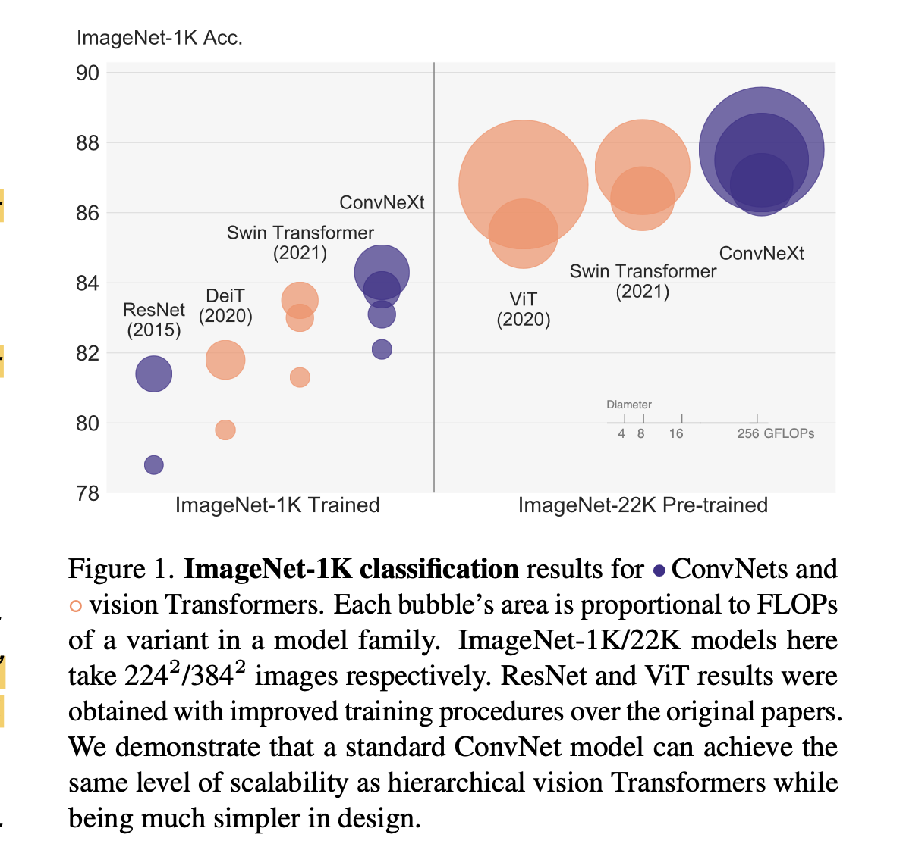
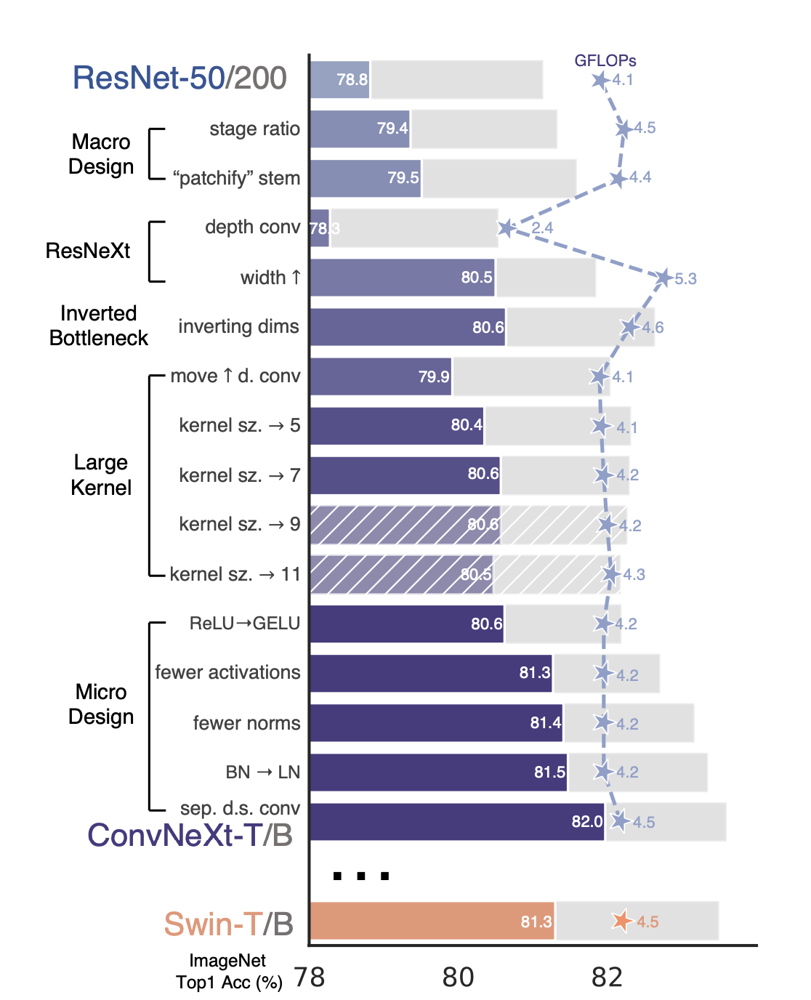
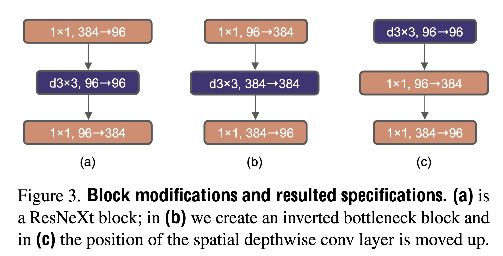
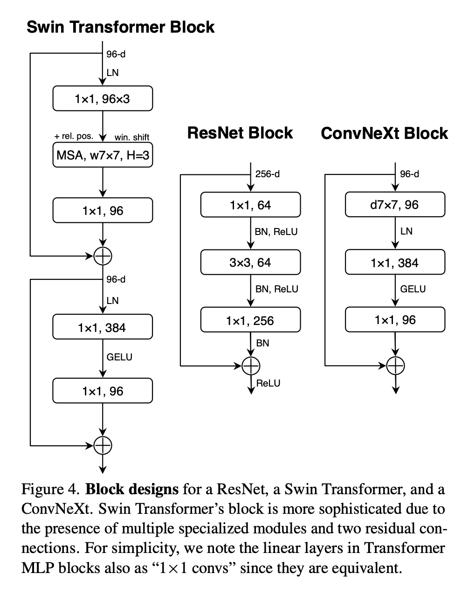
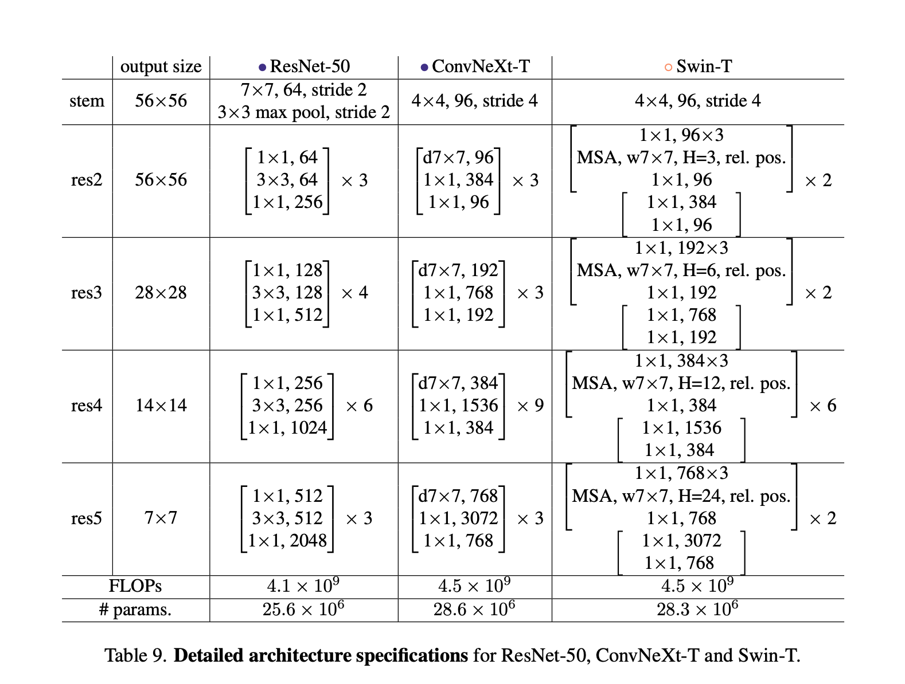
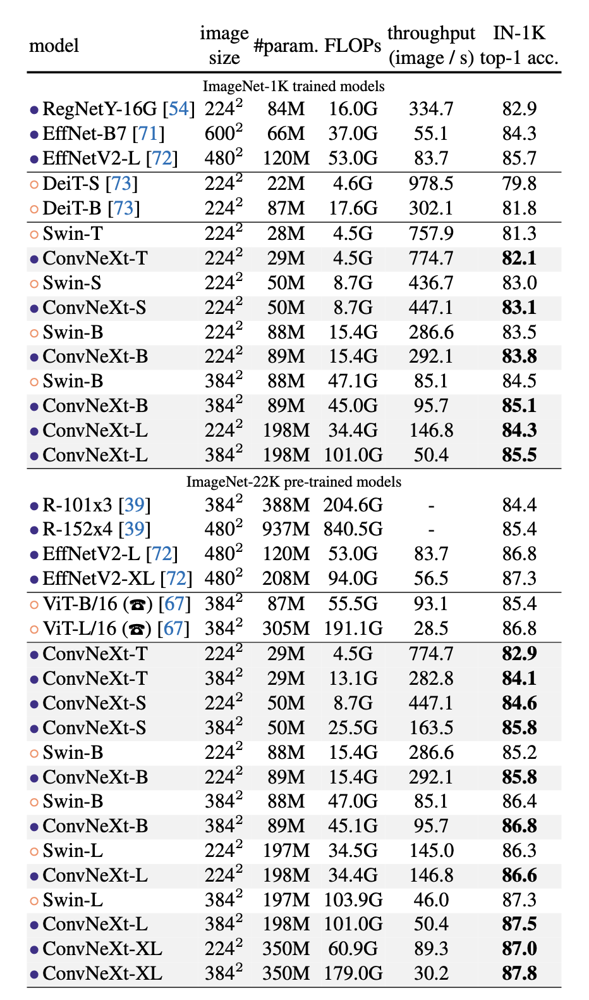
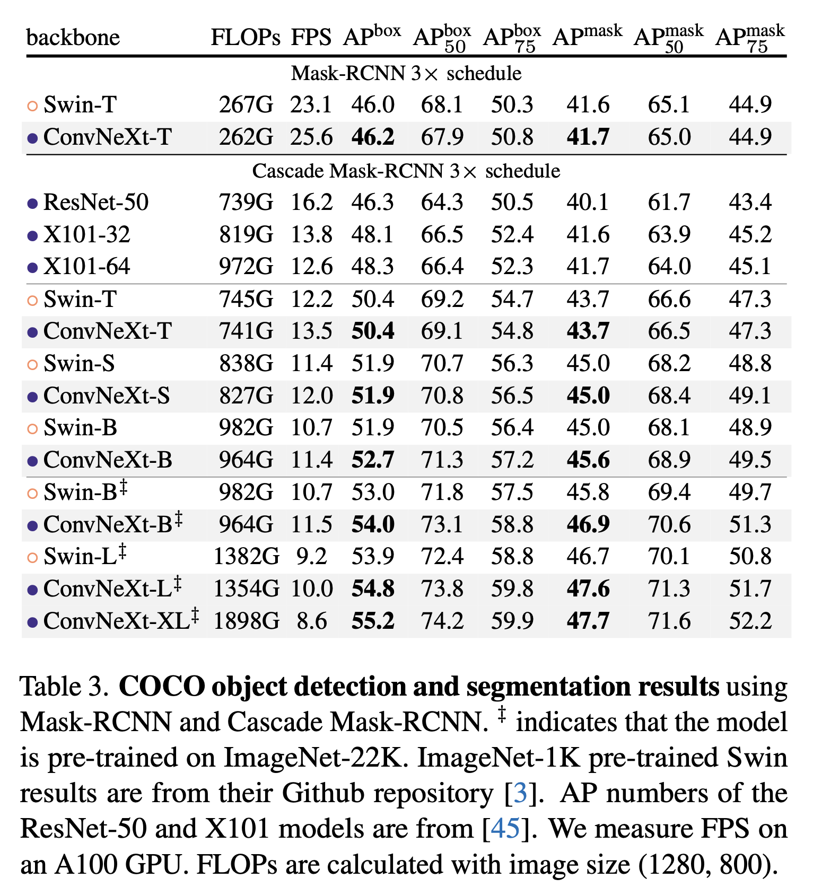
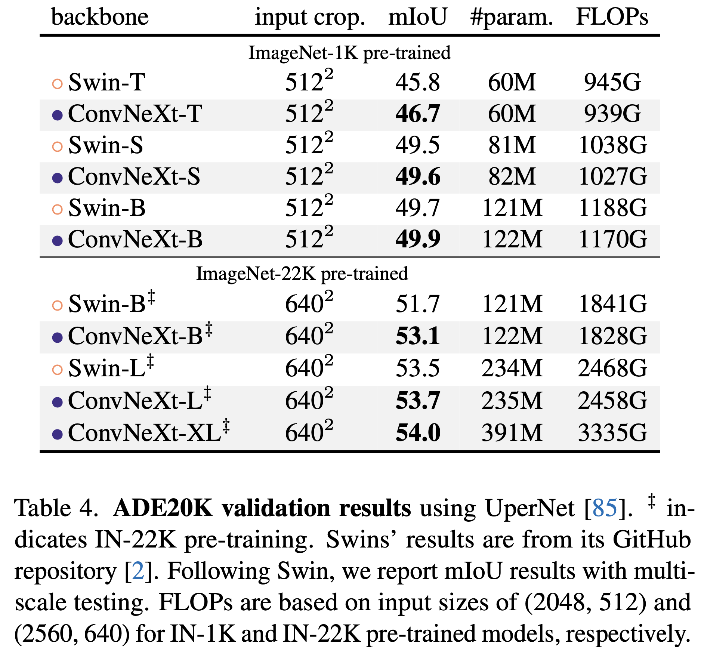

# Summary Notes (ConvNext)


## Resources
- Paper: https://arxiv.org/abs/2201.03545
- Github: https://github.com/facebookresearch/ConvNeXt
- Paper explanation videos: 
  - Aleksa Gordic: https://www.youtube.com/watch?v=idiIllIQOfU
  - AI Coffee break with Letitia: https://www.youtube.com/watch?v=QqejV0LNDHA&t=80s

## Introduction
- In 2020, Vision Transformers (ViTs) began to outperform ConvNets as the state-of-the-art for image classification.

- However, vanilla ViTs faced challenges when applied to general computer vision tasks like object detection and semantic segmentation.
  - *"a vanilla ViT model faces many challenges in being adopted as a generic vision backbone. The biggest challenge is ViT’s global attention design, which has a quadratic complexity with respect to the input size. It becomes quickly becomes intractable with higher-resolution inputs."*

- Hierarchical Transformers (e.g., Swin Transformers) reintroduced several ConvNet design principles, making Transformers more viable for a wide range of vision tasks. The “sliding window” strategy (e.g. attention within local windows) allowing them to behave more similarly to ConvNets.

- The authors argue that the effectiveness of these hybrid approaches is often credited to the intrinsic superiority of Transformers rather than the inherent benefits of convolutions.

- ConvNeXt is a a pure convolutional neural network (ConvNet) architecture designed to compete with modern vision Transformers.
- It a Modernized version of a standard ResNet architecture step-by-step. The authors incorporated design elements from vision Transformers such as stage compute ratio, "patchify" stem, fewer normalization layers and activations, etc.

- ConvNeXt maintains the simplicity and efficiency of standard ConvNets while incorporating beneficial design choices from Transformers. They achieve performance on par with or better than state-of-the-art vision Transformers like Swin Transformers across various computer vision tasks. Moreover, like Transformers they shows good scaling behavior with model size, similar to vision Transformers.

<p>

</p>


- The paper challenges the notion that Transformers are inherently superior to ConvNets for computer vision tasks, showing that properly designed ConvNets can be equally effective and scalable. 

- In essence, the paper bridges the gap between traditional ConvNets and modern vision Transformers, demonstrating that many of the advantages of Transformers can be incorporated into a pure ConvNet design.


## ResNet --> ConvNext 
- Gradually modernizes a standard ResNet towards a design resembling vision Transformers.
- Considers two model sizes in terms of FLOPs similar to Swin-T and Swin-B respectively: 
  - ResNet-50
  - ResNet-200

<p>

</p>


### Training techniques
- Trains the baseline ResNet-50 with similar training techniques similar to DeiT's and Swin Transformer's.
- Some notable changes are:
  - Training is extended to 300 epochs from the original 90 epochs
  - Use the AdamW optimizer
  - Used Data augmentation techniques:
     - Mixup
     - Cutmix
     - RandAugment
     - Random Erasing

  - Regularization schemes used:
     - Stochastic Depth
     - Label Smoothing

- They obtain much improved results compared to the original ResNet-50 from 76.1% to 78.8% (+2.7%) by using updated training scripts. All accuracies are reported on ImageNet-1K.

- Note, authors fixed training recipe with the same hyperparameters throughout the "modernization" process.

- Each reported accuracy on the ResNet-50 regime is an average obtained from training with three different random seeds.


### Macro Design Changes

1. **Stage compute ratio**
   - Adjust the number of blocks in each stage from (3, 4, 6, 3) in ResNet-50 to (3, 3, 9, 3) to match Swin-T's 1:1:3:1 ratio.
   - This change improves model accuracy from 78.8% to 79.4%.

2. **Patchify**
   - Stem cell design processes the input images at the network’s beginning. It aggressively downsample the input images to an appropriate feature map size and usually works due to features redundancy in the images.
   - Replace the ResNet-style stem (7x7 conv, stride 2, followed by max pool) with a simpler "patchify" layer (4x4 conv, stride 4) similar to Swin-T
   - This change maintains similar performance, moving from 79.4% to 79.5%.
  
### ResNext-ify
- The authors adopt the idea of ResNeXt, which has a better FLOPs/accuracy trade-off than vanilla ResNet.

- ResNeXt uses grouped convolution, where convolutional filters are separated into different groups. The extreme case of grouped convolution is depthwise convolutions where the number of groups equals the number of channels.

- **Depthwise convolution is similar to the weighted sum operation in self-attention, operating on a per-channel basis. The combination of depthwise conv and 1x1 convs leads to a separation of spatial and channel mixing, a property shared by vision Transformers.**

- Using depthwise convolution reduces the network FLOPs and initially decreases accuracy. However, increasing the network width to compensate for the capacity loss, matching Swin-T's channel count (from 64 to 96) brings the network performance to 80.5% with increased FLOPs (5.3G).


### Inverted Bottleneck
- Transformer blocks create an inverted bottleneck, where the hidden dimension of the MLP block is four times wider than the input dimension. This design is connected to the inverted bottleneck used in ConvNets, popularized by MobileNetV2 and used in several advanced ConvNet architectures.

- The authors use inverted bottleneck design in the ConvNet model.

- The change reduces the overall network FLOPs from 5.27G to 4.6G, mainly due to the significant reduction in FLOPs in the downsampling residual blocks' shortcut 1x1 conv layer.

- The change slightly improved performance (80.5% to 80.6%) despite the reduced FLOPs.

### Large Kernel Sizes
- Large kernels were used in early ConvNets, the standard became stacking small (3x3) kernel layers, popularized by VGGNet.
- Swin Transformers use local windows of at least 7x7, significantly larger than the 3x3 kernels in ResNe(X)t.
- The depthwise conv layer is moved up in the block, similar to how the MSA block is placed before MLP layers in Transformers. This intermediate step reduces FLOPs to 4.1G but temporarily decreases performance to 79.9%.
- The authors experiment with various kernel sizes: 3, 5, 7, 9, and 11. The network's performance increases from 79.9% (3x3) to 80.6% (7x7), while FLOPs remain roughly the same.

<p>

</p>


### Micro-design changes
1. **Replacing ReLU with GELU**:
   - They substitute ReLU activation with GELU, which is used in advanced Transformers.
   - This change maintains the same accuracy (80.6%).

2. **Fewer activation functions**:
   - They remove all GELU layers except one between two 1x1 layers, mimicking a Transformer block.
   - This improves the result by 0.7% to 81.3%, matching Swin-T's performance.

2. **Fewer normalization layers**:
   - They remove two BatchNorm layers, leaving only one before the conv 1x1 layers.
   - This further boosts performance to 81.4%, surpassing Swin-T.


3. **Substituting BN with LN**:
   - They replace BatchNorm with LayerNorm, which is commonly used in Transformers.
   - This change slightly improves performance to 81.5%.

4. **Separate downsampling layers**:
   - They use 2x2 conv layers with stride 2 for spatial downsampling between stages.
   - This initially leads to diverged training, but adding normalization layers wherever spatial resolution changes helps stabilize training.
   - This improves accuracy to 82.0%, significantly exceeding Swin-T's 81.3%.


<p>

</p>



## Model Variants

- The authors introduce different ConvNeXt variants: ConvNeXt-T/S/B/L, designed to have similar complexities to Swin-T/S/B/L.

- They also introduce a larger ConvNeXt-XL to further test scalability.

- The variants differ in the number of channels C and the number of blocks B in each stage.

```
- ConvNeXt-T: C = (96, 192, 384, 768), B = (3, 3, 9, 3)
- ConvNeXt-S: C = (96, 192, 384, 768), B = (3, 3, 27, 3)
- ConvNeXt-B: C = (128, 256, 512, 1024), B = (3, 3, 27, 3)
- ConvNeXt-L: C = (192, 384, 768, 1536), B = (3, 3, 27, 3)
- ConvNeXt-XL: C = (256, 512, 1024, 2048), B = (3, 3, 27, 3)
```

## Results on ImageNet Classification
1. **Training Settings**:
   - For ImageNet-1K training, they use a 300-epoch schedule with AdamW optimizer, various data augmentations, and regularization techniques.
   - For ImageNet-22K pre-training, they use a 90-epoch schedule with similar settings.
   - Fine-tuning on ImageNet-1K is done for 30 epochs with specific learning rate and regularization adjustments.
   - See Section 3.1 for detailed training settings


2. **ImageNet-1K top-1 accuracy**:
   


3. **Isotropic ConvNeXt vs. ViT**:
   - The authors create isotropic versions of ConvNeXt (without downsampling layers) to compare with ViT.
   - These isotropic ConvNeXt models perform on par with ViT, showing that the ConvNeXt block design is competitive even in non-hierarchical models.


## Results on Downstream Tasks
1. **Object Detection and Segmentation on COCO**: The authors fine-tune Mask R-CNN and Cascade Mask R-CNN on the COCO dataset

<p>

</p>

1. **Semantic Segmentation on ADE20K**: They evaluate ConvNeXt backbones on ADE20K semantic segmentation task using UperNet

<p>

</p>

Note, the authors use the final model weights (instead of EMA weights) from ImageNet pre-training as network initializations for the downstream tasks.


**The properly designed ConvNets can compete with or outperform state-of-the-art vision Transformers across various model sizes and training regimes, while maintaining the simplicity and efficiency advantages of traditional ConvNets.**

> See the appendix in the paper for more details on architecture, resnet-200 results and training configs.